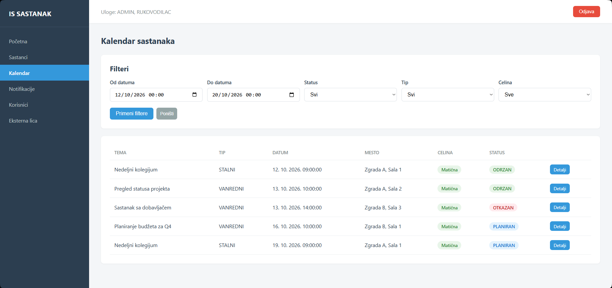

# IS SASTANAK: Meeting Management System

Full-stack web information system for planning, running and documenting company meetings, councils and committees. Built end-to-end to a formal specification under a fixed deadline, from requirements analysis and UML modelling to a containerized microservice deployment.



## Features

- **Meeting lifecycle:** scheduling, agenda, participants, postponement and cancellation with mandatory justification, recurring meetings (six periodicity types)
- **Calendar** with filtering by date range, status, type and organizational unit
- **Attendance tracking** with business-rule validation (agenda at least 3 days ahead, attendance window up to 72h after the meeting) and participant substitution
- **Reports and export:** meeting minutes and attendance reports as PDF, XLSX and DOCX
- **Users, roles and external participants:** admin-managed accounts, permanent and temporary roles, external persons with organization and country
- **Notifications** on changes made by other users

## Architecture

```
React SPA (Vite + TypeScript)
        │  REST / JWT
        ├── auth-service     :8001   accounts, roles, JWT login/refresh
        ├── meeting-service  :8002   meetings, agenda, attendance, calendar, notifications
        └── report-service   :8003   minutes, attendance reports, PDF/XLSX/DOCX export
                   │
              PostgreSQL 16
```

- **3 independent REST microservices, 42 endpoints**, sharing one PostgreSQL database
- **Stateless auth:** the auth service issues JWTs, other services verify them locally with a shared secret, so there is no network call per request
- **Business logic in Python, not in the database:** the schema has no procedures or triggers, which keeps every rule unit-testable
- **Two-layer authorization on sensitive endpoints:** role check (RBAC) plus resource-ownership check, preventing privilege escalation by editing IDs in the URL
- **Refresh-token rotation** with a blacklist on refresh and logout

## Tech stack

| Layer | Technology |
|---|---|
| Backend | Python 3.12, FastAPI, SQLAlchemy 2.0, Pydantic |
| Auth | JWT (access + refresh), bcrypt |
| Frontend | React 19, TypeScript, Vite, React Router |
| Database | PostgreSQL 16 |
| Infrastructure | Docker, Docker Compose, Kubernetes (minikube) |
| Export | reportlab (PDF), openpyxl (XLSX), python-docx (DOCX) |
| Testing | pytest, httpx, in-memory SQLite |
| Process | Git, GitHub Projects (Scrum board) |

## Roles (RBAC)

| Capability | Admin | Manager | Recorder | Participant |
|---|:---:|:---:|:---:|:---:|
| Account management | ✓ | | | |
| Plan meetings | | ✓ | | |
| Run meetings, record attendance | | ✓ | ✓ | |
| Calendar | ✓ | ✓ | | |
| Reports, notifications | ✓ | ✓ | ✓ | ✓ |

Full matrix: `docs/matrica_uloga.xlsx`. Implemented with FastAPI `Depends()` guards in each service's `dependencies.py`.

## Quick start

Requires Docker Desktop and Node.js.

```bash
git clone https://github.com/AleksaKostur/is-sastanak.git
cd is-sastanak
docker compose up --build -d     # PostgreSQL + 3 services

cd frontend
npm install
npm run dev                      # http://localhost:5173
```

Swagger docs: `localhost:8001/docs`, `localhost:8002/docs`, `localhost:8003/docs`.

There is no public sign-up (accounts are created by an admin), so the first admin account is created directly in the database. Step-by-step commands are in the [full documentation](docs/README_sr.md#6-podešavanje-test-podataka). Kubernetes deployment steps are in the same document.

## Tests

23 automated tests (pytest, in-memory SQLite, no production database needed):

- **auth-service (12):** login, token contents, RBAC per role, blocking access to other users' data via URL, blocking self-assignment of the admin role
- **meeting-service (11):** periodicity validation, the 3-day agenda rule, the 72h attendance window, internal vs. external participant validation

```bash
cd services/auth-service && pip install -r requirements.txt && python -m pytest tests/ -v
```

## Documentation

- [Full technical documentation (Serbian)](docs/README_sr.md): design decisions, business rules, specification coverage, known limitations
- `docs/dijagrami/`: use-case, context, DFD and decomposition diagrams
- `docs/erd.png`, `docs/schema.sql`: ER diagram and database schema

## Known limitations

- Refresh-token blacklist is in memory (Redis in production)
- Kubernetes database has no PersistentVolumeClaim (demo setup)
- Frontend runs in dev mode, outside Docker Compose

---

Built by [Aleksa Kostur](https://www.linkedin.com/in/aleksakostur), with Claude Code as an AI-assisted engineering workflow.
